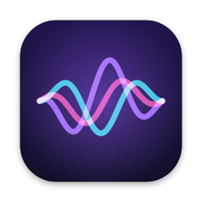

<p align="center">
  
</p>

<h1 align="center">Diktor</h1>

<p align="center"><b>Голосовая диктовка для Mac, которая работает без интернета.</b><br>
Нажал клавишу, говоришь, и текст появляется там, где стоит курсор: с точками, запятыми, абзацами и списками.</p>

<p align="center">
  <a href="https://github.com/1ROST1/Diktor/releases/latest"><b>⬇︎ Скачать Diktor</b></a>
</p>

---

## Подойдёт ли мой Mac

Нужны две вещи:

- **Чип Apple:** M1, M2, M3, M4 или новее.
- **macOS 14 Sonoma** или новее.

Как проверить: нажми  в левом верхнем углу и выбери **«Об этом Mac»**. В строке **«Чип»** должно быть написано *Apple M…*, а в строке **«macOS»** — *Sonoma 14*, *Sequoia 15* или новее.

> На Mac с процессором Intel Diktor не работает.

## Что нужно установить дополнительно

**Ничего.** Python, Xcode, Homebrew и Терминал не понадобятся. Всё, что нужно, уже внутри приложения.

Единственное, что Diktor скачает сам при первом запуске, — модель распознавания речи (~225 МБ). Для этого один раз нужен интернет, дальше он не нужен совсем.

---

## Установка: 5 шагов, ~3 минуты

### Шаг 1. Скачай

Открой страницу **[Releases](https://github.com/1ROST1/Diktor/releases/latest)** и нажми на файл **`Diktor-x.x.dmg`** (самая новая версия). Он скачается в «Загрузки».

### Шаг 2. Перетащи в «Программы»

Открой скачанный `.dmg` двойным кликом. Появится окно с иконкой **Diktor** и папкой **«Программы»**. Перетащи Diktor на папку «Программы».

После этого окно можно закрыть, а сам `.dmg` удалить.

### Шаг 3. Первый запуск

Открой **Программы → Diktor**. macOS покажет предупреждение вроде *«Не удалось проверить Diktor на наличие вредоносного ПО»*. Это нормально: так macOS реагирует на любое приложение, которое не проходило платную проверку Apple. Нажми **«Готово»** (или «Отменить»), затем:

1. Открой **Системные настройки → Конфиденциальность и безопасность**.
2. Пролистай вниз. Там будет строчка про Diktor и кнопка **«Всё равно открыть»**. Нажми её.
3. Подтверди паролем или Touch ID и ещё раз нажми **«Открыть»**.

Это делается **один раз**. Дальше Diktor запускается как обычное приложение.

<details>
<summary>Не нашёл кнопку? Есть способ через Терминал</summary>

Открой **Терминал** (через Spotlight: ⌘ + Пробел, набери «Терминал»), вставь команду и нажми Enter:

```
xattr -dr com.apple.quarantine /Applications/Diktor.app
```

После этого Diktor откроется без предупреждения.
</details>

### Шаг 4. Выдай разрешения

Diktor откроет окно настройки. Нужны два разрешения, напротив каждого появится зелёная галочка:

| Разрешение | Зачем | Что сделать |
|---|---|---|
| **Универсальный доступ** | Чтобы слышать горячие клавиши и вставлять текст в любое приложение | Нажми **«Разрешить»** → откроются Настройки → включи переключатель напротив **Diktor** |
| **Микрофон** | Чтобы слышать тебя во время диктовки | Нажми **«Разрешить»** → **«Разрешить»** в системном окне |

В этом же окне:
- **Модель распознавания** скачается сама, прогресс видно прямо там.
- **«Клавиша 🎤 (F5) запускает Diktor»** — включено по умолчанию. Клавиша микрофона на MacBook будет запускать Diktor вместо встроенной диктовки macOS.
- **«Запускать при входе в систему»** — включи, чтобы Diktor всегда был под рукой.

Нажми **«Готово»**.

### Шаг 5. Пользуйся

В строке меню вверху справа появится иконка-волна. Это и есть Diktor.

---

## Как диктовать

1. Поставь курсор туда, куда нужен текст: Заметки, Telegram, браузер, Word, почта, куда угодно.
2. Нажми **🎤 (F5)** или **дважды быстро правый ⌘**. Рядом появится анимация, идёт запись.
3. Говори.
4. Снова нажми **🎤** или **дважды правый ⌘**. Появится галочка, и текст вставится.

**Esc** во время записи отменяет её.

### Голосовые команды

| Скажи | Получится |
|---|---|
| «новый абзац» | пустая строка, новый абзац |
| «новая строка» | перенос строки |
| «новый пункт» | элемент списка `- …` |
| «двоеточие», «точка с запятой», «тире» | `:` `;` `—` |
| «вопросительный знак», «восклицательный знак» | `?` `!` |
| «открыть кавычки» … «закрыть кавычки» | «…» |
| «открыть скобку» … «закрыть скобку» | (…) |

Точки, запятые и заглавные буквы Diktor ставит сам, числа пишет цифрами. «Э-э» и «мм» убирает.

### Две модели на выбор (в меню Diktor)

- **GigaAM v3** — по умолчанию. Лучшее качество для русского.
- **Parakeet v3** — если в речи много английских слов, названий и терминов. При первом выборе скачается (~460 МБ).

### AirPods

Если подключены AirPods, Sony или другие Bluetooth-наушники, Diktor всегда пишет встроенным микрофоном Mac. Запись начинается сразу, а звук в наушниках не портится: они не переключаются в режим гарнитуры («звонка»). Остальные приложения (Zoom, Telegram) продолжают слушать микрофон наушников. Исключение — закрытая крышка MacBook: встроенный микрофон тогда выключен, и Diktor пишет микрофоном наушников.

### Музыка

Если на Mac играет музыка или видео, на время записи звук плавно приглушается до 20% и потом возвращается. Выключается в меню: «Приглушать музыку во время записи».

### Память

Когда ты не диктуешь, Diktor через 3 минуты выгружает модель и занимает около 30 МБ. При следующем нажатии модель загружается, пока ты говоришь, так что задержки нет. Режим выключается в меню: «Экономить память».

---

## Если что-то не работает

<details>
<summary><b>Нажимаю клавишу — ничего не происходит</b></summary>

- Посмотри на иконку Diktor в строке меню. Если там ⚠︎, открой меню и выбери **«Выдать разрешения…»**.
- Если в Настройках переключатель Diktor уже включён, а приложение всё равно просит доступ: выдели Diktor в списке **Универсальный доступ**, удали его кнопкой **«−»** и снова нажми «Разрешить» в окне Diktor.
- Правый ⌘ нужно нажать **дважды быстро**, примерно как двойной клик, ничего не удерживая.
</details>

<details>
<summary><b>Пишет «Тишина — проверь микрофон»</b></summary>

Diktor слушает микрофон, выбранный в **Настройки → Звук → Вход**. Проверь, что выбран нужный микрофон и полоска уровня двигается, когда говоришь.
</details>

<details>
<summary><b>Текст не вставился</b></summary>

Некоторые поля не принимают вставку, например поля паролей. Текст не пропадает: в меню Diktor есть пункт **«Скопировать последний текст»**, после этого вставь его через ⌘V.
</details>

<details>
<summary><b>Клавиша 🎤 на внешней клавиатуре не работает</b></summary>

Не на всех клавиатурах есть клавиша микрофона. Используй **двойной правый ⌘**, он работает везде.
</details>

<details>
<summary><b>Хочу вернуть встроенную диктовку macOS на клавишу 🎤</b></summary>

В меню Diktor выключи **«Клавиша 🎤 (F5) запускает Diktor»**. Или просто выйди из Diktor через меню: клавиша сразу вернётся к обычной работе.
</details>

---

## Обновление

Diktor раз в день сам проверяет, не вышла ли новая версия. Если вышла, на иконке появится точка, а вверху меню пункт «Доступна версия …». Там написано, что нового, и есть кнопка «Скачать». Проверить вручную: меню → «Проверить обновления…».

Новые модели распознавания тоже приходят с новой версией Diktor, отдельно их обновлять не нужно.

Чтобы обновиться, скачай новый `.dmg` из [Releases](https://github.com/1ROST1/Diktor/releases/latest), выйди из Diktor (меню → «Выйти из Diktor») и перетащи новую версию в «Программы» с заменой. Разрешения и модель сохранятся.

## Удаление

1. Меню Diktor → **«Выйти из Diktor»**.
2. Перетащи **Diktor** из «Программ» в Корзину.
3. Чтобы освободить место от моделей, удали папку `~/Library/Application Support/Diktor`. Если пользовался Parakeet, удали ещё `~/Library/Application Support/FluidAudio`. В Finder: меню «Переход» → «Переход к папке…» → вставь путь.

## Приватность

- Всё распознаётся **на твоём Mac**. Голос и текст никуда не отправляются.
- Звук живёт только в оперативной памяти во время диктовки и сразу удаляется, на диск он не пишется.
- История диктовок не ведётся, аналитики нет.
- Единственное обращение в интернет — скачивание модели с Hugging Face при первом запуске.

---

© 2026 1ROST1. Бесплатно для личного использования, исходный код закрыт ([LICENSE](LICENSE)).
Открытые компоненты, на которых построен Diktor, и их лицензии: [THIRD_PARTY_NOTICES.md](THIRD_PARTY_NOTICES.md).
